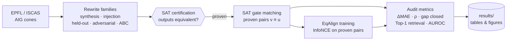

<div align="center">

# CertAudit &nbsp;·&nbsp; EqAlign

### Same Function, Different Answer
**Certified Auditing and Repair of Equivalence Blindness in Circuit Representation Models**

<p>


</p>

*Anonymous repository for double-blind review. It contains the code, the certified audit set, the aggregated results and the extended version of the paper.*

[**Extended paper (PDF)**](paper/certaudit_extended.pdf) &nbsp;|&nbsp; [Quick start](#-quick-start) &nbsp;|&nbsp; [Reproduce](#-reproducing-the-paper) &nbsp;|&nbsp; [Data](#-the-certified-audit-set) &nbsp;|&nbsp; [Results](#-headline-results)

</div>

---

## Why this exists

Circuit representation models are trained to capture **what a gate computes**. If they do, two gates that compute the same Boolean function should get the same prediction and nearby embeddings, however the surrounding logic is rewritten.

**CertAudit** tests that premise. It rewrites circuits by logic synthesis and by injecting redundant logic, **proves with SAT** that every rewrite preserves function, and **proves which gates correspond**. It then measures how a model's predictions and embeddings move across those proven pairs.

**EqAlign** is the repair we study: a contrastive loss that pulls together individual gates proven equivalent.



## 📊 Headline results

376 EPFL test circuits, mean ± s.d. over 5 seeds, recurrent encoder of width 64 (Table I of the paper).
`ρ` is the disagreement between two proven-equivalent gates divided by the model's own error (0 is perfect consistency, 1 means the model moves as much as it errs). Top-1 is how often the nearest original gate is the proven equivalent (chance 2.2%).

| Regime | MAE ↓ | ρ synthesis ↓ | ρ injection ↓ | ρ held-out ↓ | Top-1 seen ↑ | Top-1 held-out ↑ |
|:--|:-:|:-:|:-:|:-:|:-:|:-:|
| Baseline | 0.0189 | 0.85 | 1.26 | 3.98 | 41.0 | 23.1 |
| Augmentation | 0.0179 | 0.86 | 0.87 | 4.17 | 44.5 | 23.7 |
| TT-sim (DeepGate2-style) | **0.0171** | 0.90 | 0.94 | 4.37 | 42.5 | 23.8 |
| Circuit-level contrast | 0.0199 | 0.89 | 1.01 | 3.76 | 40.6 | 23.7 |
| **EqAlign** | 0.0216 | **0.77** | **0.66** | **3.41** | **63.4** | **33.3** |

Three findings, in the paper's words:

1. **Models are equivalence blind.** Under re-synthesis a model stays accurate yet moves its prediction for a fixed function by about as much as it errs, at every size from 46k to 11.6M parameters.
2. **Training on certified rewrites steadies predictions, mostly against redundancy. Among our regimes, only gate-level contrastive alignment repairs the representation.**
3. **No tested repair survives an unseen XOR-based rewrite.** Five released encoders lose at least half of their retrieval on it.

The aggregated results of the GPU experiments are in [`results/`](results/).

## 🗂 Repository layout

```
.
├── core/                 the method: AIG library, certification, SAT matching, encoders, losses, metrics
│   ├── aiglib.py           AIG representation, synthesis passes, redundancy injection, certification
│   ├── certdata.py         rewrite families and SAT-proven gate matching
│   ├── model.py            recurrent, bidirectional and transformer encoders
│   ├── train.py            baseline, augmentation, TT-sim, circuit contrast, L1 alignment, EqAlign
│   ├── evaluate.py         the audit metrics (ΔMAE, ρ, gap closed, Top-1, AUROC, worst case)
│   ├── stats.py            design-level bootstrap intervals, sign tests, Holm correction
│   ├── dg2.py              audit and fine-tuning of released DeepGate2
│   └── sweep.py            SAT-sweeping probe
├── tools/                experiment orchestration: plan → run_queue → select → aggregate
├── scripts/              one-command entry points (run_all.sh, run_supplements.sh, setup, data check)
├── configs/              data manifest and reference values for the environment check
├── data/                 the certified audit set (see below)
├── results/              aggregated results of the GPU experiments and of the solver test (CSV / JSON)
├── checkpoints/cpu_run/  the 15 models of the CPU run (5 regimes × 3 seeds)
├── cpu_run/              the earlier CPU pipeline (hyp, released-checkpoint audits, sweep timings, solver test)
├── paper_pipeline/       the scripts that turn run outputs into the paper's numbers, tables and figures
├── paper/                extended version (PDF) and LaTeX sources
└── docs/                 REPRODUCE.md (paper item → command), EXPERIMENTS.md (protocol of each experiment)
```

## 🚀 Quick start

```bash
# 1. environment (CPU is enough for the smoke test; training at paper scale wants GPUs)
conda create -n certaudit python=3.11 -y && conda activate certaudit
pip install torch                       # or a CUDA build: see pytorch.org
pip install -r requirements.txt

# 2. check the audit set (sizes and MD5 of every file)
python scripts/verify_data.py --summary

# 3. smoke test (about one minute on a laptop CPU): train a small EqAlign encoder for one epoch and audit it
bash scripts/smoke_test.sh
```

The smoke test writes `runs/smoke/` and prints the audit metrics of the model it trained. It checks the pipeline, not the paper's numbers.

## 🔁 Reproducing the paper

Everything is driven by four tools, always in this order:

| Step | Command | What it does |
|:--|:--|:--|
| plan | `python -m tools.plan <EXP> <phase>` | writes the job list `jobs/<EXP>_<phase>.jsonl` |
| run | `python -m tools.run_queue jobs/<EXP>_<phase>.jsonl --gpus 0,1 --per-gpu 2` | trains and evaluates; resumable |
| select | `python -m tools.select <EXP> <phase>` | picks learning rate and loss weights **on validation only** |
| aggregate | `python -m tools.aggregate <EXP>` | writes `results/<EXP>/summary.csv`, `comparisons.csv`, `claims.md` |

The whole main pipeline is one command (resumable; about 1.5 to 2.5 days on 8 GPUs, CPU-bound):

```bash
bash scripts/setup_third_party.sh all                    # DeepGate2 code + data, ABC, EPFL benchmarks
GPUS=0,1,2,3,4,5,6,7 PER_GPU=3 bash scripts/run_all.sh   # E0 → E3 → E1a → E8 → E9 → E12 → E13 → E10 → E1b → E4 → E2
bash scripts/run_supplements.sh E14                      # then E15, E1c, E16, E17
```

`STOP_AFTER=E1a bash scripts/run_all.sh` stops after a given experiment. Table I and Figs. 2 and 3 need only `E1a` and `E8`.

<details>
<summary><b>Which experiment produces which part of the paper</b></summary>

| Paper item | Experiment | Content |
|:--|:--|:--|
| Table I, Fig. 2, Fig. 3, RQ1, RQ2 | `E1a`, `E8` | 7 regimes at widths 64 and 256, 5 seeds; mechanism controls (no negatives, no head, frozen encoder, filtered TT-sim) |
| RQ2, simulation-matched pairs | `E14` | EqAlign trained on pairs matched by 64-bit and 4,096-bit signatures instead of proofs |
| RQ2, leave-one-family-out | `E12` | one rewrite family removed from training, tested on that family |
| RQ2, H2 is learnable | `E9` | XOR-rewrite variants added to training |
| RQ2, 4× certified data | `E4` | 1, 2 or 4 certified variants per training circuit |
| RQ3, Fig. 4 | `E5` (`RUN_E5=1`) | SAT-sweeping probe |
| Table II ISCAS | `E1a` (suite `iscas`) | EPFL-trained models on ISCAS85/89 |
| Table II other architectures | `E2` | bidirectional encoder and transformer |
| Table II released / retrained / fine-tuned DeepGate2 | `E3`, `E10` | released weights, fine-tuning with and without EqAlign, retraining from the released code |
| RQ4 model size | `E1b`, `E1c`, `E15` | widths 128 to 1024, 4 rounds, transformer 512 |
| RQ4 large circuits | `E13` | 503 to 5,497 gates |
| RQ4 ABC scripts | `E17` | resyn2, dc2, compress2rs, LUT round trip; certified twice |
| RQ4 confirmatory design, released TRACE / MGVGA / FGNN2, Fig. 4b timings, solver test | `cpu_run/` | see `docs/REPRODUCE.md` |

</details>

Full instructions, expected run times and the protocol of every experiment are in [`docs/REPRODUCE.md`](docs/REPRODUCE.md) and [`docs/EXPERIMENTS.md`](docs/EXPERIMENTS.md).

## 🧪 The certified audit set

Every equivalence in `data/` is **proven by SAT**, both at the circuit outputs and gate by gate. Circuits are random fanin cones of the EPFL combinational suite (20 to 392 gates, up to 64 inputs) and of ISCAS85/89.

| File | Content |
|:--|:--|
| `data.pkl` | 2,750 training circuits (275 held for validation) from 11 EPFL designs, each with one certified variant; 376 test circuits from 7 disjoint designs, each with 7 fixed variants (S1 to S4, I.1, I.3, I.5) and their proven pairs |
| `heldout.pkl` | held-out families H1 (don't-care synthesis) and H2 (XOR-based rewrite) of every test circuit |
| `adv.pkl` | 16 sampled adversarial variants per test circuit |
| `abc.pkl` | four ABC rewrites of every EPFL and ISCAS test circuit, certified by two independent checkers |
| `iscas.pkl` | 678 test circuits from ISCAS85 and the combinational cores of ISCAS89, with fixed and held-out variants |
| `data_hyp.pkl`, `heldout_hyp.pkl` | 60 circuits of the confirmatory design `hyp`, never used in development |
| `full_variants.pkl` | five full EPFL designs with four certified variants each (SAT-sweeping probe) |
| `pairs_sig64.pkl`, `pairs_sig4096.pkl` | training pairs matched by simulation signatures only (control for RQ2) |
| `examples.pkl` | candidate example pairs for Fig. 1 |

In total the EPFL test side holds **9,396 certified variants and 642k proven gate pairs**. A sample is a dictionary with `n_pi`, `fanins` (AIG literals), `pos`, `prob` (signal probabilities from 4,096 shared patterns), `lev` and `src`; a variant adds the proven pairs `I`, `J` and their polarity `P`. Details: [`data/README.md`](data/README.md).

Generating new certified data is one call:

```python
from core.certdata import variant, match               # rewrite + certify, then SAT gate matching
```

## 📐 Protocol in one paragraph

All regimes share the encoder, the optimizer (Adam, one-cycle cosine), 12 epochs and 5 seeds. Learning rate is chosen on the baseline's validation MAE. Each loss weight is chosen by one rule fixed in advance: the highest restructured retrieval on validation with validation MAE within 25% of the baseline. No test result enters selection. Comparisons are made at design level (cluster bootstrap over designs, two-sided sign test, Holm correction on ISCAS). The rules that decide whether a result supports a claim were written before each experiment ran and are evaluated by `tools/aggregate.py`.

## ✅ What was run in this exact package

| Check | Status |
|:--|:--|
| `scripts/verify_data.py` | passes |
| `scripts/smoke_test.sh` (train + audit on CPU) | passes |
| LaTeX sources in `paper/latex` compile to the two PDFs | passes |
| Full GPU pipeline (`scripts/run_all.sh`) | this is the code that produced `results/`; it was not re-run from this packaged copy |
| `cpu_run/`, `paper_pipeline/` | provided as used, with paths made relative; they need the run outputs and were not re-run from this copy |

Model weights of the GPU run are not included (they are regenerated by the pipeline, a few hundred kilobytes each at width 64). The 15 checkpoints of the CPU run are in `checkpoints/cpu_run/`.

## 🧩 Third-party code

Released models are audited with their authors' code at fixed commits, fetched by `scripts/setup_third_party.sh`: python-deepgate (`173db75`), ABC (`f34d3b2`), and the EPFL benchmark suite. Synthesis uses the EPFL logic synthesis libraries through `aigverse 0.1.7`; SAT uses CaDiCaL 1.5.3 through PySAT.

## License

MIT, see [`LICENSE`](LICENSE). Author information is withheld for double-blind review.
